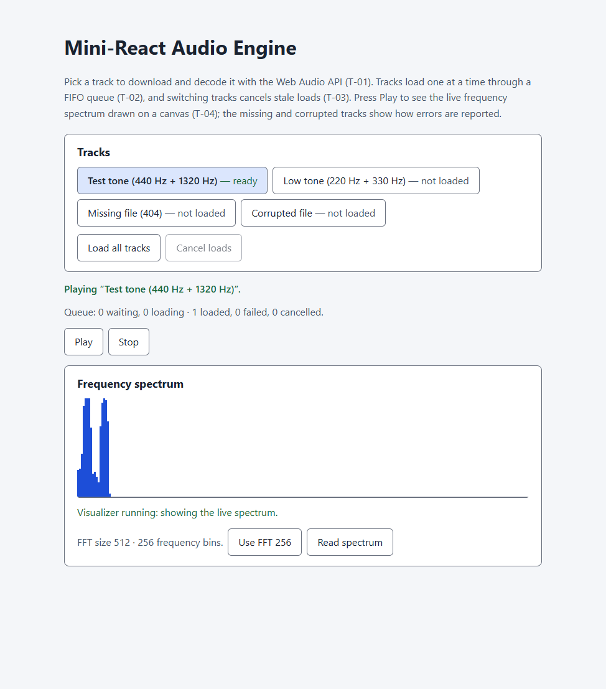

# REPORT LAB2 — Mini-React Audio Engine

Audio engine and visualizer built on the Mini-React core in `../source/`
(`createElement`, `renderToDOM`, `events`, `testHarness`). The core is
imported, not copied. Code is in `source/`.

Serve from the `LAB2/` folder so the `../../source/` imports resolve:

```
cd LAB2
python -m http.server 8765
```

- Demo: http://localhost:8765/HW/audio/source/audio.demo.html
- Tests: http://localhost:8765/HW/audio/source/audio.test.html

## T-01 — Web Audio engine foundation

Commit: `feat(audio): implement Web Audio engine and analyser`

| File | Responsibility |
| --- | --- |
| `source/audioEngine.js` | Shared `AudioContext`, `AudioBufferSourceNode → AnalyserNode → destination` graph, fetch + `decodeAudioData`, `play` / `stop` / `getAnalyser` / `getFrequencyData` / `setFftSize` / `dispose`, `AudioEngineError` codes |
| `source/mountAudioPlayer.js` | Player UI (track list, live status, Play/Stop, spectrum reading) rendered with Mini-React and wired through root event delegation |
| `source/audio.css` | Contrast-checked player styles |
| `source/assets/tone-a440.wav` | 3 s test tone (440 Hz + 1320 Hz) |
| `source/assets/corrupted.wav` | Plain text with a `.wav` name, for decode-error testing |

Key decisions:

- The `AudioContext` is created lazily on first load and reused for every
  track. `play()` calls `resume()` first, so a context suspended by the
  autoplay policy starts on the user's click.
- `fftSize` is 512 by default (256 frequency bins); 256 (128 bins) is
  supported through `setFftSize(256)`. Other sizes throw a `TypeError`.
- Every `play()` creates a new `AudioBufferSourceNode`; `stop()` clears its
  `onended` handler and disconnects it.
- `getFrequencyData()` fills one reused `Uint8Array`, so the T-04 animation
  loop will not allocate per frame.
- Failures throw an `AudioEngineError` whose `code` is `invalid-url`,
  `network`, `http`, `decode`, `not-ready`, `suspended`, `unsupported` or
  `disposed`. The UI shows the message in a `role="status"` live region.
- Project rules: semantic markup only (`section`, `h2`, `ul`, `button`, `p`,
  no `div`); every prop and option is type-checked; all text goes through
  `createTextNode` / `textContent`; the UI tree is mounted once through
  `renderToDOM`.

Tests at T-01: 34/34 passed (headless Edge 155). They cover the audio
graph with a fake context, plus a real `AudioContext` decoding the WAV and
rejecting the missing and corrupted files.

## T-02 — FIFO loading and decoding queue

Commit: `feat(audio): implement FIFO loading and decoding queue`

| File | Responsibility |
| --- | --- |
| `source/audioQueue.js` | DOM-free FIFO scheduler: `enqueue`, `processNext`, `clearPending`, `getQueueStatus`, `subscribe`, `dispose` |
| `source/mountAudioPlayer.js` | Every track load now goes through the queue; per-track state, queue summary, "Load all tracks" and "Cancel waiting loads" |
| `source/assets/tone-a220.wav` | Second valid tone (220 Hz + 330 Hz) so several real loads can be queued |

Key decisions:

- **One active job** (`MAX_ACTIVE_JOBS = 1`). Jobs start in the order
  `enqueue` accepted them, and with one worker they also finish in that
  order. If more workers are added later, FIFO will mean start order only.
- **One job = whole lifecycle.** A job's `run` is `engine.load(url)` from
  T-01 (validate URL → fetch → status check → `arrayBuffer` →
  `decodeAudioData`). Downloads and decodes are never launched outside the
  queue. The engine itself is unchanged and still usable on its own.
- **Job states:** `QUEUED → RUNNING → SUCCESS | ERROR`, and
  `QUEUED → CANCELLED` via `clearPending()`. A job leaves the pending list
  exactly once, so it can only run once. Terminal jobs leave the queue at
  once; only counters and a capped history (20) are kept.
- **Failures never block.** A rejected or synchronously throwing `run`
  becomes `ERROR` with the original error kept on the job; the slot is
  released before the next job starts.
- **No lost errors.** `enqueue` returns `{ id, done }`; `done` resolves to
  the job's final snapshot and never rejects, so failures are reported
  through `status` / `error` instead of unhandled rejections.
- **Occasional UI updates.** The UI subscribes once and updates the queue
  summary text and track labels in place on each queue change (enqueued,
  started, succeeded, failed, cleared); nothing is re-rendered.
- Decoded buffers are cached per track, so choosing a loaded track again
  does not download it again. Choosing a failed track retries it.
- Aborting the *running* job is left to T-03 (AbortController).

Tests: `source/audio.test.html` — 50/50 passed (headless Edge 155). The
queue tests use deferred jobs with controlled completion to check start
order, that at most one job is ever active, that failures and synchronous
throws do not block the queue, cancellation, history capping and
notifications. One integration test queues four real loads (valid, 404,
corrupted, valid) and checks the outcomes arrive in submission order. A
mutation check (removing the single-slot guard) made 5 queue tests fail.

## T-03 — Resource cleanup and request cancellation

Commit: `fix(audio): prevent resource leaks and cancel stale requests`

| File | Change |
| --- | --- |
| `source/audioEngine.js` | `load(url, { signal })`, active-source registry, `play(..., { isCurrent })`, shared-context ownership, `onDispose()` hooks, full `dispose()`, `aborted` error code and `isAbortError()` |
| `source/audioQueue.js` | One `AbortController` per job (`run({ signal })`), `cancel(idOrKey)`, `cancelAll()`; stale outcomes ignored; history no longer keeps results |
| `source/mountAudioPlayer.js` | Switching tracks cancels the previous choice's load; selection generation guards Play; "Cancel loads" aborts running and waiting loads; cancellation is never shown as an error |

Key decisions:

- **Source nodes.** Playing nodes live in an `activeSources` set. A node
  leaves it exactly once (stop, replacement, natural `ended`, dispose):
  its `onended` is cleared, it is stopped if still running (an
  `InvalidStateError` from an already-stopped node is ignored) and
  disconnected. A late `ended` event from a replaced node does nothing.
  `stop()` and `dispose()` are safe to repeat.
- **Abort per request.** The queue gives every job its own
  `AbortController`. `engine.load()` makes another controller per load,
  linked to the job's signal, and passes it to `fetch()`. The engine can
  abort its own loads on dispose without aborting the caller's signal, and
  cancelling one track never touches another. The link listener is removed
  when the load ends.
- **Decode cannot be aborted.** `decodeAudioData()` takes no signal. If
  the signal fires while it runs, the decode is left to finish, its buffer
  is dropped, and the load rejects with `aborted` and the message "its
  decode had already started and its result was discarded". It never
  claims the decode was stopped.
- **Cancelling a running job frees the slot at once,** so the next job
  starts without waiting for a decode that cannot be aborted. Whatever the
  cancelled `run()` resolves or rejects with later is ignored (job status
  is no longer `RUNNING`). Trade-off: such a decode may overlap the next
  job's download for a moment; its result is never used.
- **Stale results.** A settled load only changes the status line if its
  track is still selected. Choosing another track cancels the load the
  previous choice started (loads from "Load all" are kept, since the user
  asked for all of them). Play captures the selection generation and
  passes `isCurrent` to `engine.play()`, which checks it after the context
  resumes and right before the source starts.
- **Cancellation is not failure.** Cancelled jobs are `CANCELLED`, never
  `ERROR`, even if `run()` rejects with an `AbortError`. The UI shows
  "Cancelled N loads." in the normal (not error) style and never marks a
  cancelled track as failed. `done` promises never reject, so there are no
  unhandled rejections.
- **Disposal.** Player `dispose()`: unsubscribe → `queue.dispose()`
  (cancel waiting jobs, abort the running one, refuse new jobs) → drop
  buffers → empty the root → `engine.dispose()` (abort loads, run
  `onDispose` hooks such as the T-04 animation frame, stop sources,
  disconnect the analyser, close the context). The queue's history keeps
  outcomes but not results, so decoded `AudioBuffer`s can be freed.
- **Shared context.** `createAudioEngine({ context })` borrows a context:
  the engine disconnects its own analyser and sources but never closes the
  borrowed context.
- **Event listeners.** The player's only native listener is the root
  click delegation from `HW/source/events.js`. That module has no detach
  and registers each root once, so remounting never stacks listeners; the
  per-element handlers live in a `WeakMap` and go away with the removed
  elements.

Tests: `source/audio.test.html` — 74/74 passed (3 runs, headless Edge 155).
New tests cover abort during download, abort while decoding, an
already-aborted signal, the source registry with a late `ended` event,
repeated stop, `isCurrent` dropping a stale Play, dispose while resuming,
shared-context ownership, dispose hooks, per-job signals, cancelling
running and queued jobs, `cancelAll`, rapid track switching in the UI,
Cancel loads, and player disposal with loads pending. One integration test
cancels a real in-flight download and checks the next real load still
decodes.

Mutation checks (each made tests fail, then the code was restored):

| Mutation | Failing tests |
| --- | --- |
| Queue accepts a cancelled job's late result | 3 |
| UI stops passing `isCurrent` to `play()` | 1 |
| UI stops cancelling the previous selection's load | 1 |

## T-04 — Real-time canvas frequency visualizer

Commit: `feat(audio): implement performant real-time frequency visualizer`

| File | Change |
| --- | --- |
| `source/audioVisualizer.js` | DOM-free drawing loop: `createVisualizer(canvas, { getFrequencyData, isActive })` with `start` / `stop` / `dispose`, one `requestAnimationFrame` loop, bars drawn on the 2D context, `ResizeObserver` sizing |
| `source/mountAudioPlayer.js` | New "Frequency spectrum" section (heading, `<canvas role="img">` with fallback text, visualizer status, analyser info, FFT 256/512 toggle, Read spectrum); Play starts the loop, Stop / natural end / track switch / dispose stop it |
| `source/audio.css` | Visualizer styles; `--audio-bar` (6.70:1 on white) |
| `source/*.js`, `audio.test.html` | Imports fixed from `../../HW/source/` to `../../source/`: the T-03 folder move (`LAB2/AUDIO` → `LAB2/HW/audio`) had left them pointing at a missing path, so the demo and tests did not load |



Key decisions:

- **Canvas, not SVG.** 256 bins (FFT 512) or 128 bins (FFT 256) as SVG
  elements would mean hundreds of attribute writes per frame. On canvas a
  frame is one `fillRect` per bar.
- **No per-frame state or DOM.** The loop calls `engine.getFrequencyData()`
  (the engine's single reused `Uint8Array`) and draws. It never calls
  `setStatus`, builds a VNode or touches an element. Text changes only on
  events: play, stop, end, track switch, load and error. A test watches the
  player root with a `MutationObserver` for 60 frames and records zero
  mutations.
- **One loop.** `start()` returns `false` while a frame is pending, so
  pressing Play twice or switching tracks never adds a loop. The frame
  callback is one function created once, so scheduling allocates no
  closures.
- **Stopping.** `stop()` cancels the stored frame id and draws a flat
  baseline. The loop also ends itself when `isActive()`
  (`engine.isPlaying`) turns false, so playback ending by any path (natural
  end, `engine.stop()`, a replaced source) stops drawing after one baseline
  frame.
- **Cleanup.** `dispose()` cancels the frame, disconnects the
  `ResizeObserver` (or removes the window `resize` listener when
  `ResizeObserver` is missing) and refuses later `start()` calls. The
  player registers it with `engine.onDispose()` (T-03), so disposing either
  the player or the engine on its own stops the loop. The player
  unregisters that hook when it is disposed.
- **Sizing.** The canvas is `width: 100%` and 10rem tall (7.5rem below
  30rem wide). The backing store is the CSS size × `devicePixelRatio` and
  changes only in the `ResizeObserver` callback, so frames never read
  layout. Colors are read from CSS custom properties on resize, not per
  frame.
- **Bars.** One bar per bin when there is room, otherwise neighbouring bins
  share a bar showing their peak value. Bars stay at least 3 CSS px wide
  with integer edges, so nothing is anti-aliased into a blur.
- **Missing analyser.** `getFrequencyData` returning `null` or an empty
  array draws the baseline. If it throws (e.g. the engine is gone), the
  loop logs the error once and stops instead of throwing every frame. If
  `getContext("2d")` returns `null`, the status line shows the fallback
  message and playback still works.
- **FFT size.** The "Use FFT 256 / 512" button calls `engine.setFftSize()`.
  The next frame reads the resized array.
- Frame rate follows `requestAnimationFrame`: about 60 FPS on a 60 Hz
  display. It is lower in background tabs and on slow hardware.

Tests: `source/audio.test.html` — 97/97 passed (headless Edge 155 with
`--autoplay-policy=no-user-gesture-required`; the two real-playback tests
need autoplay allowed, so in a normal browser click the page and reload
if they report a suspended context). New tests use a manual frame
scheduler and a fake `ResizeObserver` to count loops exactly. They cover
argument checks, a single loop under repeated `start()`, typed-array
reuse, pixel checks of bars and baseline, peak grouping, zero DOM mutations
per frame, `stop()`, the self-ending loop, missing or throwing data,
device-pixel-ratio sizing, a real `ResizeObserver` following its container,
`dispose()`, removal of the window `resize` fallback, and a canvas with no
2D context. Player tests cover the semantic section, one loop per Play,
replays and track switches, Stop / natural end, the FFT toggle, and
disposal through the player or the engine. Two integration tests use the
real engine, WAV files and `requestAnimationFrame`: live bars appear and
stop after `engine.stop()`; three track switches with double Play never
draw more visualizer frames than the browser's own animation frames.

Demo check (headless Edge, 1000 px and about 500 px wide): bars move while
the tone plays, the canvas follows the container (726 px and 407 px wide),
there is no horizontal scroll, Stop shows "Visualizer stopped", and the
console has no errors.

Mutation checks (each made tests fail, then the code was restored):

| Mutation | Failing tests |
| --- | --- |
| `start()` no longer ignores a call while a frame is pending | 4 |
| Track switch no longer stops the visualizer | 1 |

## Final integration (T-01 → T-04)

The suite runs the full workflow from §5.1:

1. Engine created lazily, one shared context (T-01).
2. "Load all" queues several tracks; downloads and decodes run one at a
   time in submission order (T-02, real WAV integration test).
3. A decoded track is selected and Play (a click) resumes the context and
   starts a source → analyser → destination graph.
4. The visualizer draws the analyser's data with `requestAnimationFrame`
   (T-04 integration tests).
5. Switching tracks while loading or playing cancels the stale load
   (`AbortController`) and drops late results; a stale Play never starts
   (T-03).
6. Stop releases the source node and ends the animation loop.
7. Dispose aborts pending loads, runs the visualizer's dispose hook
   (cancels the frame and disconnects the resize observer), stops sources
   and closes the owned context.

Final checklist:

| Item | Status |
| --- | --- |
| Four commits in order (T-01 → T-04) | Done. T-02 and T-03 were each committed twice in history (`ed2fe0d`/`1cbc557`, `af3953d`/`b30e539` folder move) |
| Web Audio API integration, FFT 256 or 512 | Done |
| FIFO queue for simultaneous requests | Done |
| AbortController cancels network requests; stale results ignored | Done |
| Source nodes cleaned up explicitly | Done |
| Visualizer uses `requestAnimationFrame`, no per-frame app render | Done |
| Animation loops and listeners cleaned up | Done |
| Existing Mini-React core untouched | Done: `LAB2/HW/source/` is unchanged; Data-Grid suite 101/101 |
