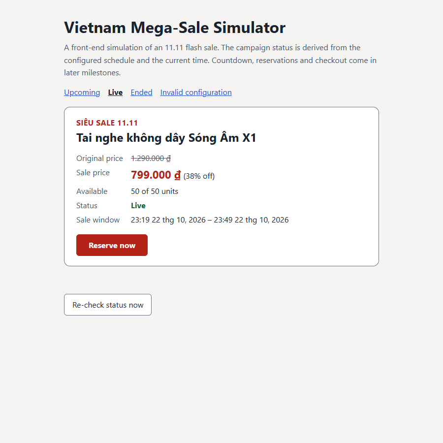
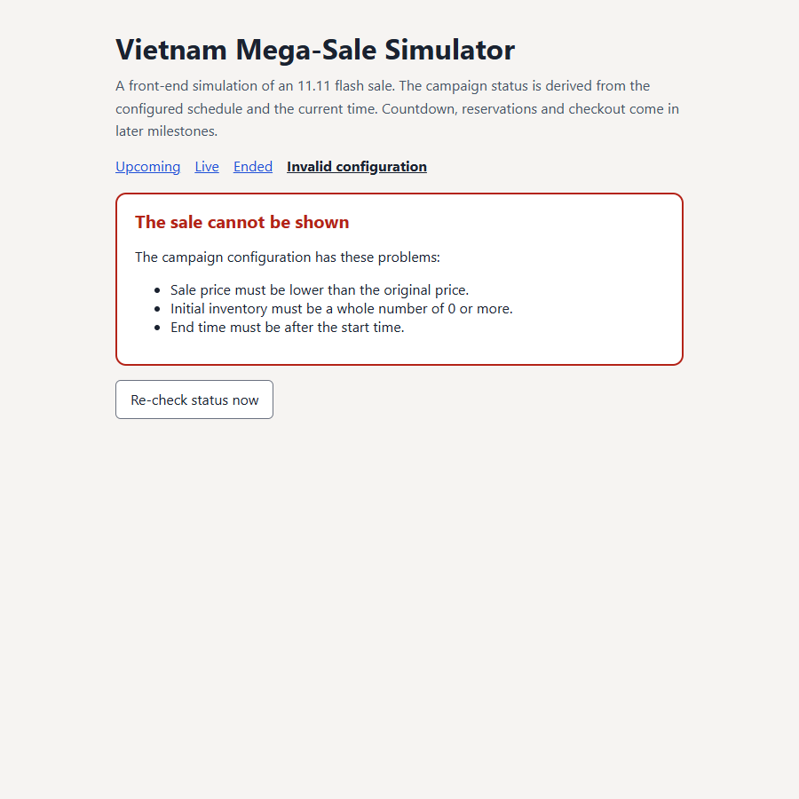
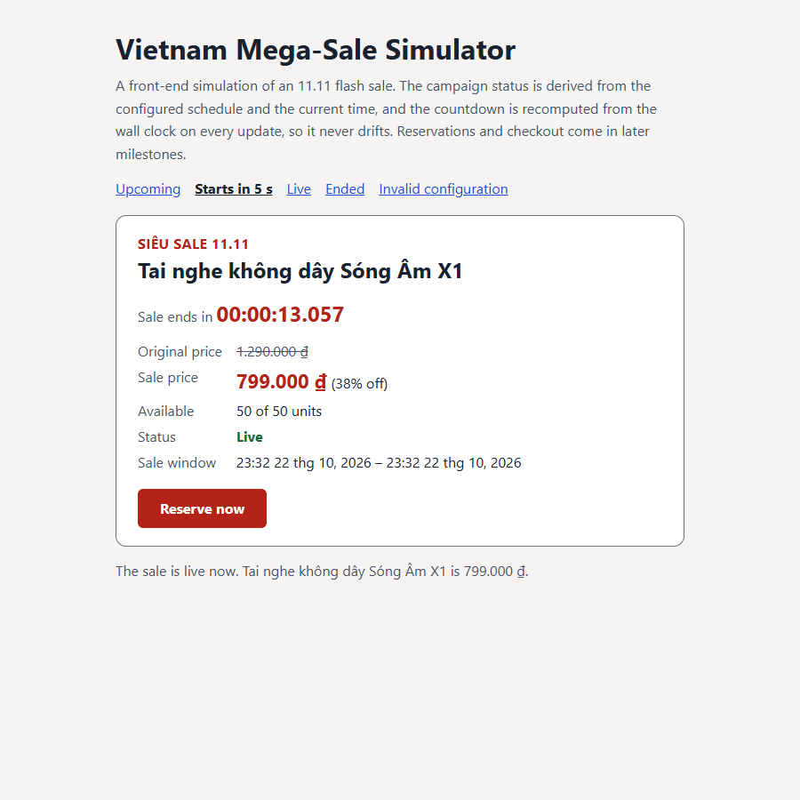
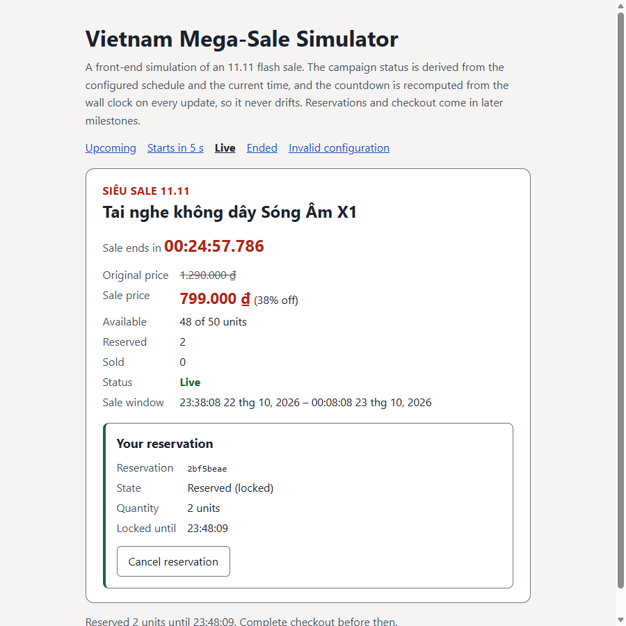

# REPORT LAB2 — Vietnam Mega-Sale Simulator

A front-end simulation of an 11.11 flash sale, built on the Mini-React core
in `../source/` (`createElement`, `renderToDOM`, `events`, `testHarness`).
The core is imported, not copied. Code is in `source/`.

This is a simulation: inventory is consistent only inside this page's
in-memory state. It is not a payment system or a distributed inventory
service, and it cannot keep stock consistent across browsers or devices.

Serve from the `LAB2/` folder so the `../../source/` imports resolve:

```
cd LAB2
python -m http.server 8765
```

- Demo: http://localhost:8765/HW/megasale/source/megaSale.demo.html
  (scenarios: `?scenario=upcoming`, `soon`, `live`, `ended`, `invalid`)
- Tests: http://localhost:8765/HW/megasale/source/megaSale.test.html

## T-01 — Mega-Sale project foundation

Commit: `feat(sale): establish mega-sale simulation foundation`

| File | Responsibility |
| --- | --- |
| `source/saleConfig.js` | Centralized campaign config: `createSampleConfig(now, options)`, `validateSaleConfig(config)` (never throws, returns every problem), `discountPercent` |
| `source/saleStatus.js` | `SALE_STATUS` (`UPCOMING`, `LIVE`, `ENDED`), labels, `getCampaignStatus(config, now)` |
| `source/productCard.js` | Pure VNode builders: `ProductCard`, `ConfigErrorView`, `primaryAction`, `createFormatters` |
| `source/mountMegaSale.js` | Mounts the card and a live region through `renderToDOM` and root event delegation; per-mount state; `refresh()` / `dispose()` |
| `source/megaSale.css` | Contrast-checked styles, single-column layout under 30rem |
| `../source/renderToDOM.js` | Adds `lang` to the attribute allow-list, so Vietnamese text can be marked `lang="vi"` (WCAG 3.1.2). Nothing else changed |

Existing architecture, inspected before writing code: the project has no
`main.js` or `index.js`. Each feature has a `mount*.js` that renders with
`renderToDOM`, wires clicks through `attachRootEventDelegation` and keeps
state in a per-mount closure (the pattern from `mountDataGrid.js` and
`mountAudioPlayer.js`). The global `useState` store in
`EXERCISE/sources` was not used, because it is shared by the whole page
(AI_AUDIT_FAILURE_1, Defect 1). The Mega-Sale follows the same structure.



Key decisions:

- **Units.** Timestamps are Unix epoch milliseconds (as `Date.now()`),
  durations are milliseconds (`lockDurationMs`), and prices are whole
  Vietnamese đồng. VND has no minor unit, so prices are integers and never
  floats.
- **Config fields.** `campaignName`, `productName`, `originalPrice`,
  `salePrice`, `initialInventory`, `startsAt`, `endsAt`, `lockDurationMs`,
  `timeZone`. The PRD's field list has no end time, but `ENDED` cannot be
  derived without one, so `endsAt` was added. `timeZone`
  (`Asia/Ho_Chi_Minh`) makes the shown times Vietnam time on any machine.
- **Sample data.** `createSampleConfig(now)` places the sale relative to
  `now` (it starts in 2 minutes and runs 30), so the simulator always has
  something to show. A fixed 11.11 date would be stuck on "Upcoming" or
  "Ended" for most of the year. The demo's scenario links shift the start
  to show each status.
- **Status is derived, never stored.** `getCampaignStatus(config, now)` is
  the single rule: `now < startsAt` → `UPCOMING`, `startsAt ≤ now < endsAt`
  → `LIVE`, otherwise `ENDED`. The card, the button and `handle.status` all
  call it. The clock is injected (`options.now`, default `Date.now`), so
  tests check exact boundaries.
- **Validation without crashing.** `validateSaleConfig` checks types and
  rules: non-empty names, positive integer prices, sale price below the
  original, inventory a non-negative safe integer (0 allowed), integer
  timestamps with `endsAt > startsAt`, a positive lock duration and a valid
  IANA time zone. It returns all problems at once. An invalid config shows a
  `<section role="alert">` listing them, and no card is built from bad
  data. Wrong argument *types* passed to `mountMegaSale` (a missing root,
  props that are not an object) still throw a `TypeError` before the root is
  touched, as in the other modules.
- **Prices told apart by text.** Each price has its own `<dt>` label
  ("Original price", "Sale price"), because screen readers do not announce
  `<del>` by default. The original price is struck through and muted; the
  sale price is a large red `<strong>`; the discount is written out
  ("(38% off)").
- **Primary button follows the status.** `UPCOMING`: "Opens at HH:mm"
  (disabled); `LIVE`: "Reserve now"; `LIVE` with 0 stock: "Sold out"
  (disabled); `ENDED`: "Sale ended" (disabled). In T-01, Reserve only
  announces in the live region that reservations are not available yet.
  The reservation FSM comes in a later milestone.
- **Focus.** `refresh()` re-renders the card. If focus was inside it,
  focus returns to the new button, or to the product heading
  (`tabindex="-1"`) when the button becomes disabled, so keyboard users
  are never dropped to `<body>`.
- **Project rules.** Semantic markup only (`article`, `h2`, `dl`/`dt`/`dd`,
  `del`, `strong`, `output`, `time`, `button`, `section role="alert"`; no
  `div`); every prop and config value is type-checked; all text goes
  through `createTextNode` / `textContent` (an `` product name
  renders as literal text); the tree is mounted through `renderToDOM`.



Tests: `source/megaSale.test.html` — 21/21 passed (headless Edge 155).
They cover the sample config and its units, validation of every field
(including non-objects, fractional đồng, `2 ** 53` stock and an unknown time
zone), exact status boundaries (1 ms before start, at start, 1 ms before
end, at end), the semantic card, price labels and formatting, the button
in each status and when sold out, keyboard focus and focus after
`refresh()`, the error view, XSS-safe text, argument checks before the
root is touched, two independent simulators on one page, and `dispose()`.

Regression: the Data-Grid (101/101) and audio (97/97) suites still pass
after the `lang` allow-list change.

Demo check (headless Edge, 900 px and 375 px): all four scenarios render
with no console errors and no horizontal scroll. Below 30rem the facts
stack in one column and the button is full width.

Mutation checks (each made tests fail, then the code was restored):

| Mutation | Failing tests |
| --- | --- |
| Status uses `now <= startsAt` (sale opens 1 ms late) | 5 |
| Inventory check accepts any finite number | 3 |

## T-02 — Zero-drift millisecond countdown

Commit: `feat(timer): implement zero-drift sale countdown`

| File | Change |
| --- | --- |
| `source/countdown.js` | `remainingMs(target, now)`, `formatDuration(ms)` (HH:MM:SS.mmm), `createCountdown({ getTarget, onTick, onReached })` with `start` / `stop` / `dispose` |
| `source/productCard.js` | Countdown line: label plus `<time role="timer">`; sale window shows seconds |
| `source/mountMegaSale.js` | One countdown per mount: to `startsAt` while UPCOMING, to `endsAt` while LIVE; status change at the target; `options.timer` for tests |
| `source/megaSale.demo.html` | `?scenario=soon`: starts 5 s after load, ends 15 s later. The T-01 "Re-check status" button is gone because the countdown now updates the status |



Key decisions:

- **The wall clock is the only source of time.** Every update computes
  `Math.max(0, target - now())`. `setInterval` (50 ms) only decides when
  the display refreshes; nothing is counted or decremented. A test moves the
  fake clock by 50, 13, 400 and 7 ms between ticks and checks each value is
  exactly `target - now`. Another lets 25 minutes pass with a single
  callback (a throttled tab or a sleeping device) and checks the display
  reads `00:34:59.950`.
- **`setInterval`, not `requestAnimationFrame`.** Browsers pause
  `requestAnimationFrame` completely in background tabs. The sale would
  then not switch to LIVE until the tab became visible again.
  `setInterval` is throttled in background tabs (to about 1 s) but still
  runs, and because values come from the clock, the throttling causes no
  drift.
- **Fixed targets.** The target is read when the countdown starts and stays
  fixed until reached. Then `onReached` runs and `getTarget(now)` gives the
  next one (start → end → `null`). Asking with the current time means a
  clock jump past several targets lands on the right one in a single update.
  After device sleep through the whole sale, the next tick goes straight to
  "Ended" and only that is announced.
- **Formatting.** `formatDuration` pads every field, lets hours grow past 99
  (`100:00:00.000`), rounds milliseconds down (it never shows time that is
  not left) and clamps negative input to `00:00:00.000`.
- **Status update at the target.** When the start is reached, the card is
  re-rendered once (status "Live", Reserve enabled, label "Sale ends in")
  and the live region announces "The sale is live now…". At the end it
  shows `Sale ended 00:00:00.000`, announces "The sale has ended." and the
  interval is cleared. The zero before "Live" is drawn but replaced in the
  same tick by the end countdown.
- **No re-render per tick.** A tick writes only the `<time>` text, and only
  when it changed. The card is replaced only at the targets. A test watches
  the card with a `MutationObserver` for 20 ticks: same card element, and
  every mutation is on the `<time>` element. A tick where the clock did not
  move writes nothing.
- **Accessibility.** The countdown is a `<time role="timer">`. The timer
  role is not a live region, so 20 updates a second are never read aloud.
  Screen-reader users hear the status changes from the existing
  `role="status"` region instead. Digits use `tabular-nums` so the
  milliseconds do not jitter.
- **Lifecycle.** `start()` while running returns `false` and adds nothing.
  `stop()` and `dispose()` clear the interval, and a disposed countdown never
  restarts. The countdown is separate from inventory: it only knows the
  config's timestamps.

Tests: `source/megaSale.test.html` — 40/40 passed (headless Edge 155). The
19 new tests use a fake clock and a manual `setInterval`. They cover
formatting, clamping, option checks, clock-based values with irregular
ticks, a 25-minute delayed callback, arrival at each target (zero shown once,
reported once), a jump past several targets, one interval under repeated
`start()`, `stop()` / `dispose()`, an ended sale that schedules nothing,
card wiring (timer role and no live region, only the `<time>` text changes
per tick, live and ended transitions with announcements, device sleep
through the whole sale, `dispose()` clearing the interval), and one test
with real timers checking that the display tracks `Date.now()` within one
refresh.

Demo check: `?scenario=soon` shows "Sale starts in 00:00:03.075" after 2 s.
After 7 s it shows "Sale ends in 00:00:13.100" with status Live and the
announcement in the live region. There are no console errors.

Test-quality fix found here: the "no DOM mutation" checks first read
`observer.takeRecords()` after awaiting a tick. The observer callback had
already received the records as a microtask, so `takeRecords()` was
always empty and the checks could never fail. They now keep the records the
callback receives. The audio visualizer suite had the same bug and was
fixed in its own commit (`a739d94`).

Mutation checks (each made tests fail, then the code was restored):

| Mutation | Failing tests |
| --- | --- |
| Card re-rendered on every tick | 5 |
| Remaining time from `firstTick + updates × 50 ms` (an interval counter) instead of `Date.now()` | 8 |

## T-03 — Inventory reservation finite state machine

Commit: `feat(inventory): implement reservation state machine`

| File | Change |
| --- | --- |
| `source/reservationMachine.js` | `RESERVATION_STATE` (7 states), `RESERVATION_EVENT`, the frozen `TRANSITIONS` table, `transition(state, event)`, `canTransition`, `ReservationError` with codes |
| `source/inventory.js` | `createInventory(total)`: `reserve` / `release` / `commit` between the available, reserved and sold buckets; `assertInventoryInvariant` |
| `source/reservationStore.js` | The authoritative controller: `reserve`, `beginCheckout`, `completeCheckout`, `failCheckout`, `cancel`, `expire`, `activeFor`, `subscribe` |
| `source/saleConfig.js` | Adds `productId` (lowercase letters, digits, hyphens), which every reservation records |
| `source/productCard.js` | Available / Reserved / Sold rows; reserve form (labelled quantity field + submit); reservation panel (id, state, quantity, lock end, Cancel) |
| `source/mountMegaSale.js` | One store per mount; the card re-renders from store snapshots on every accepted change; focus is restored by `data-focus` key |



Key decisions:

- **One table of transitions.** `TRANSITIONS` maps each state to the events
  it accepts, with exactly the nine moves in the PRD.
  `transition(state, event)` returns the next state or throws
  `ReservationError("invalid-transition")`. A test walks all 56
  (state, event) pairs: 9 are allowed and the other 47 are rejected.
  `PURCHASED`, `EXPIRED` and `CANCELLED` have empty rows, so an expired or
  cancelled reservation can never reach checkout or purchase.
- **A reservation is a record, not a flag.** It has `id`, `productId`,
  `shopperId`, `quantity`, `createdAt`, `expiresAt` (set when it locks),
  `updatedAt`, `state` and `failure`. The store hands out frozen snapshots;
  only the store changes records, and only through `transition()`. Ids come
  from `crypto.randomUUID()` (tests inject a counter), and the store
  refuses an id it has seen before.
- **Inventory buckets.** `total = available + reserved + sold`, all
  non-negative safe integers. Stock only moves between buckets (reserve,
  release, commit). Each move checks its quantity first and changes nothing
  when rejected. The invariant is asserted after every accepted move, and
  every store notification passes a snapshot that the tests check.
- **Reserve, in PRD order.** (1) The sale is LIVE, (2) the quantity is a
  whole number ≥ 1, (3) enough stock is available, (4) the shopper has no
  active reservation. Only then is a record created and moved
  `IDLE → RESERVING`. After the simulated processing step (400 ms in the
  demo, instant in tests), checks 1 and 3 run again, because time and stock
  can change while a request is in flight. Then `inventory.reserve()` runs
  and the record moves `RESERVING → LOCKED` with
  `expiresAt = now + lockDurationMs`. Rejections in steps 1–4 create
  nothing and touch no stock. A failure after RESERVING moves it back to
  `IDLE` with the reason; stock was never taken on that path.
- **Stock is taken at lock time, not request time.** Two shoppers can both
  pass the first check for the last units. The one whose processing
  finishes first gets the lock; the other fails back to IDLE with "Only 1
  unit is available." Nothing is oversold, and a failed reservation never
  decrements `available`.
- **No double reservation.** A request that would reserve twice is
  rejected as `duplicate-reservation` while the shopper has a `RESERVING`,
  `LOCKED` or `CHECKING_OUT` reservation. In the UI the form is replaced by
  the "Reserving…" panel as soon as it is submitted, so a second click has
  nothing to submit. A test also calls the store directly to check the
  second layer.
- **Checkout guard.** `beginCheckout` accepts only `LOCKED`. A lock whose
  `expiresAt` has passed is expired on the spot (stock released) and the
  call is rejected. The same applies to `completeCheckout`, so a checkout
  that outlives its lock ends `EXPIRED`, never `PURCHASED`. Expiry is lazy
  in T-03; a timer that expires locks on its own belongs to a later
  milestone. The checkout methods exist and are tested, but the checkout
  screen is not built yet.
- **Errors the user can act on.** Every rejection is a `ReservationError`
  with a stable `code` (`not-live`, `sale-ended`, `invalid-quantity`,
  `insufficient-stock`, `duplicate-reservation`, `not-found`,
  `invalid-transition`, `reservation-expired`, `processing-failed`) and a
  plain message, shown in the live region as "Could not reserve: …". An
  unexpected error in processing is wrapped as `processing-failed` and
  keeps the original as `cause`.
- **UI.** A live sale with stock shows a `<form>` with a labelled
  `<input type="number" min="1" max="available">` and a submit button. Enter
  submits, and the default page reload is prevented. The typed value is
  kept across re-renders. An active reservation shows a `<section>` with
  its id, state, quantity, lock end (`<time>`) and a Cancel button, enabled
  only while LOCKED. After reserving, focus moves to Cancel; after
  cancelling, it moves back to the first control.
- **Scope.** The store is in-memory and per page. It keeps stock
  consistent for the reservations it sees, including several shoppers in
  one page, but it cannot coordinate browsers or devices. It is a
  simulation, not an inventory service.

Tests: `source/megaSale.test.html` — 73/73 passed (headless Edge 155). The
24 store-and-machine tests cover the state list and frozen table, every
allowed and every rejected (state, event) pair, terminal states,
inventory moves and rejected overdrafts, the invariant checker, the
reserve path and its timestamps, stock not taken while RESERVING,
rejections before the start or after the end, bad quantities, too large a
quantity, duplicates while RESERVING and while LOCKED, a second shopper,
stock running out or the sale ending while RESERVING, processing failures,
the checkout guard, lazy expiry, purchase and failed checkout, checkout
outliving the lock, cancel/expire releasing stock, and a 30-step mixed
sequence across five shoppers. The invariant is checked after every step,
and the end state is checked to see that reserved and sold match the
reservations. Nine UI tests cover the form and label, reserving (panel,
stock rows, announcement, focus), the RESERVING panel, invalid quantities
with no stock change, double submission, the prevented page reload,
cancelling, the typed value surviving a re-render, and a reservation that
stays visible at zero stock.

Demo check: reserving 2 units in `?scenario=live` shows "Available 48 of 50,
Reserved 2, Sold 0", the panel in state "Reserved (locked)" with its lock
end, and "Reserved 2 units until …" in the live region. It works at 900 px
and 375 px with no console errors.

Mutation checks (each made tests fail, then the code was restored):

| Mutation | Failing tests |
| --- | --- |
| `EXPIRED` may go to checkout | 3 |
| `cancel()` does not release stock | 2 |
| Duplicate-reservation check removed | 2 |
| Stock not re-checked after RESERVING (oversell) | 1 |

The duplicate mutation first made the suite hang instead of fail: the
test awaited a second reservation whose processing never finished. That
await is now raced against one tick.
