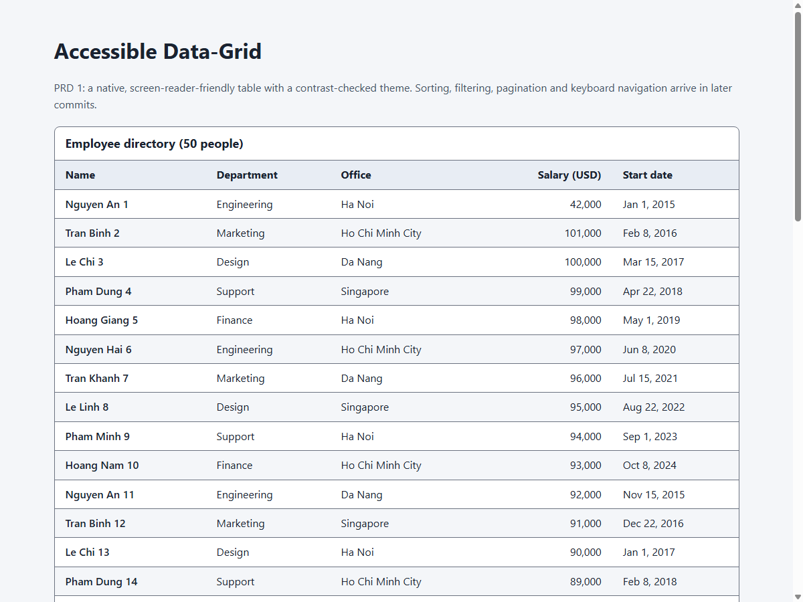
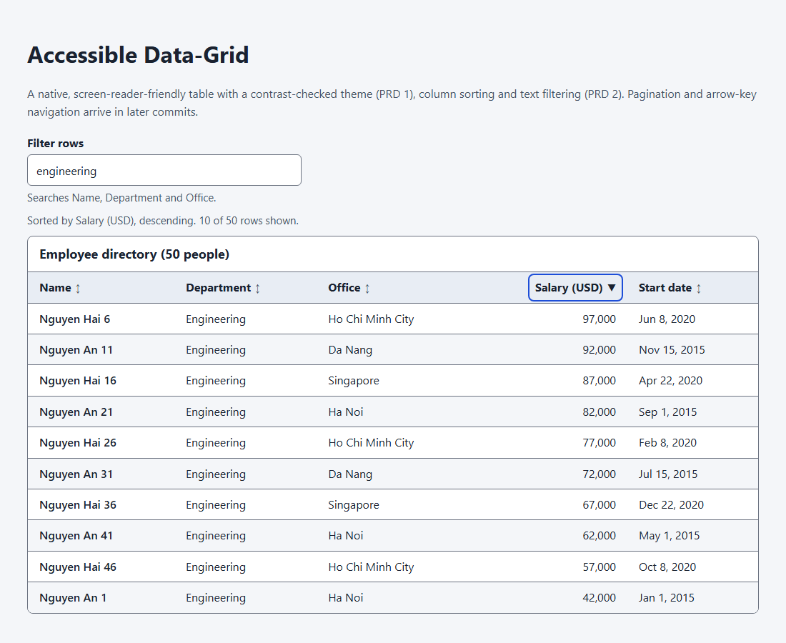
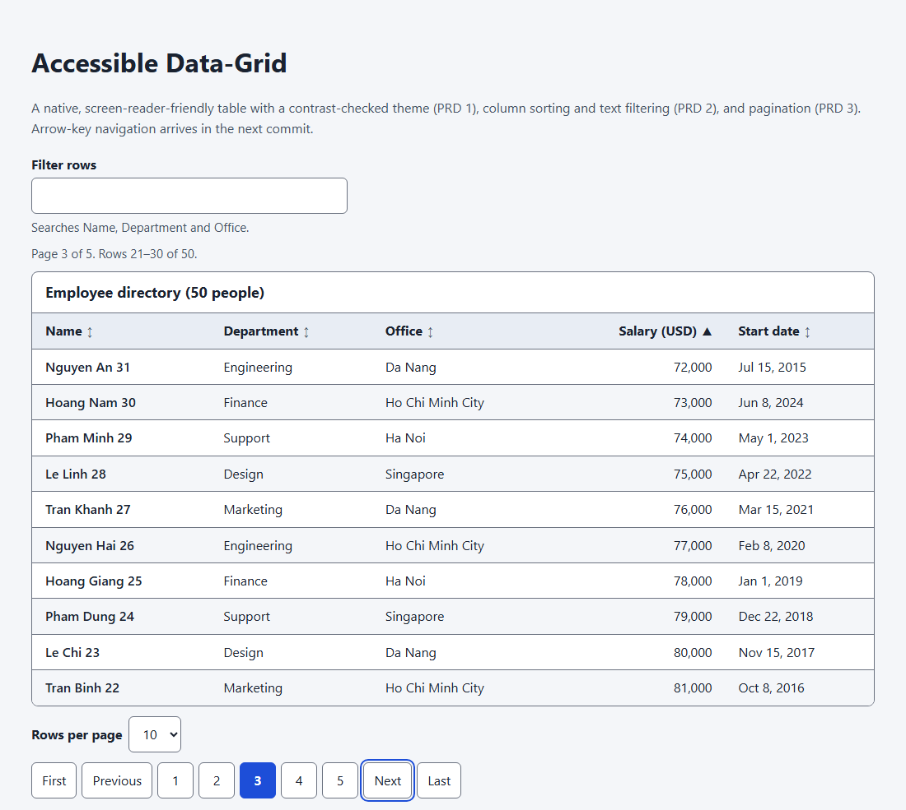
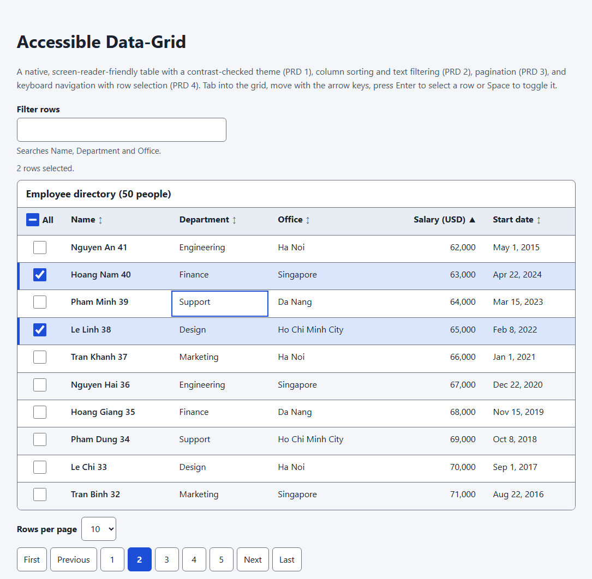
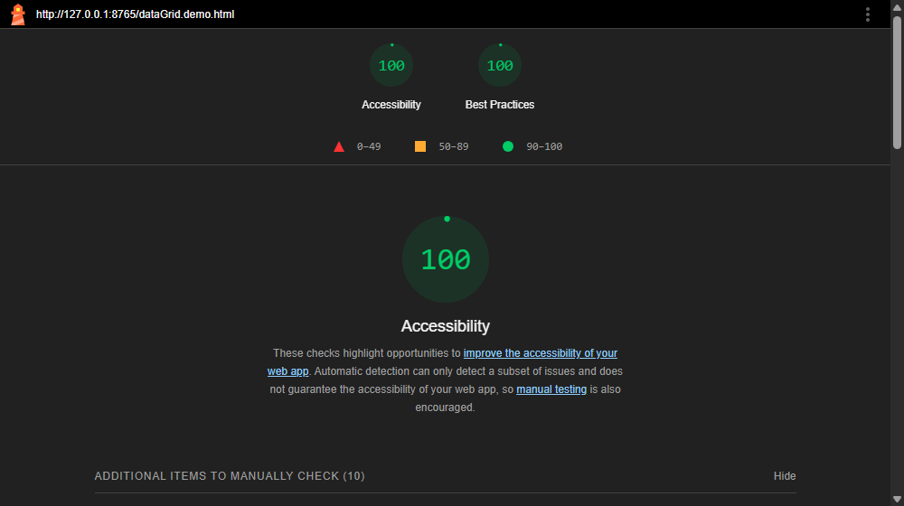

# REPORT LAB2 — HW

Accessible Data-Grid built on the Mini-React core. Code is in `source/`. Open `source/dataGrid.demo.html` through a local server (`python -m http.server` from `source/`).

## PRD 1 — Semantic table and accessible theme

final:

## PRD 2 — Sorting and filtering

final:

## PRD 3 — Pagination

final:

## PRD 4 — Keyboard navigation, selection and Lighthouse audit

final:

Lighthouse 12.2.1 — Accessibility 100, Best Practices 100 (mobile and desktop):

Full reports: [mobile](source/lighthouse/lighthouse-report-mobile.html) · [desktop](source/lighthouse/lighthouse-report-desktop.html)

Tests: `source/dataGrid.test.html` — 101/101 passed.

AI defects found and fixed: [AI_AUDIT_FAILURE_1.md](AI_AUDIT_FAILURE_1.md)
